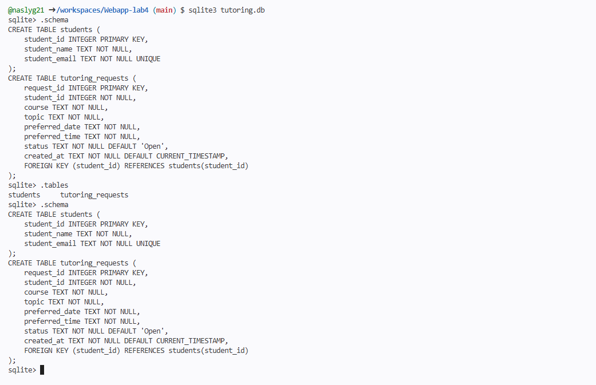
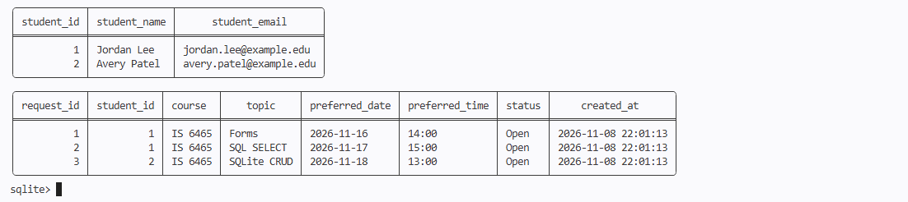
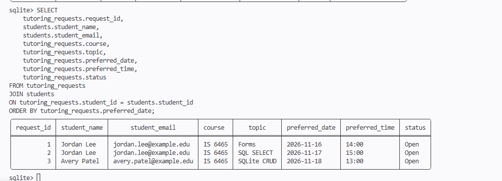
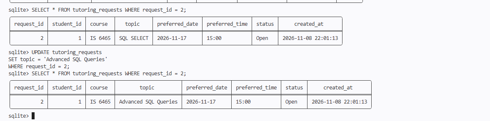
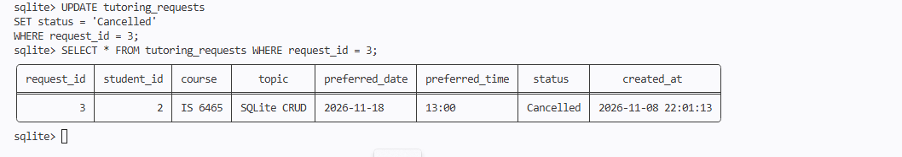
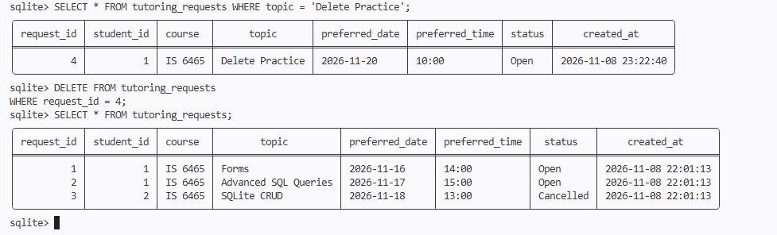

# Lab 5: Peer Tutoring Hub Database

## Part 1: Create the Database Tables

### 1. Table Names and Schema
The database contains two tables: students and tutoring_requests.

### 2. Primary Keys
The primary key in the students table is student_id. The primary key in the tutoring_requests table is request_id. Each primary key uniquely identifies a record.

### 3. Foreign Key
The foreign key is student_id in the tutoring_requests table. It connects each tutoring request to the student who submitted it.

### 4. UNIQUE Constraint
The student_email column is marked UNIQUE to prevent multiple student records from using the same email address.

## Part 2

## Part 3: Read the Stored Data

### JOIN Query Results

### Questions

**1. What does the JOIN condition connect?**

The JOIN connects the tutoring_requests table to the students table using student_id. This allows each tutoring request to display the student's name and email.

**2. What is the difference between JOIN and WHERE?**

JOIN combines related information from two tables, while WHERE filters records based on specific conditions.

**3. Why retrieve a request by request_id instead of topic alone?**

The request_id uniquely identifies each tutoring request, while multiple requests may have the same topic.s

## Part 4: Update One Request

### Update Statements

**Jordan's request:**
UPDATE tutoring_requests
SET topic = 'Advanced SQL Queries'
WHERE request_id = 2;

**Avery's request:**
UPDATE tutoring_requests
SET status = 'Cancelled'
WHERE request_id = 3;

### Before and After Results

### Cancelled Request

### Questions

**1. Why is a specific WHERE clause essential in an UPDATE statement?**

A specific WHERE clause ensures that only the intended record is updated. Without it, every row in the table could be changed.

**2. Why use Cancelled instead of immediately deleting a real request?**

Using a Cancelled status preserves the request history while showing that the tutoring session is no longer active.

## Part 5: Delete One Test Request

### INSERT Statement

INSERT INTO tutoring_requests
(student_id, course, topic, preferred_date, preferred_time)
VALUES (1, 'IS 6465', 'Delete Practice', '2026-11-20', '10:00');

### DELETE Statement

DELETE FROM tutoring_requests
WHERE request_id = 4;

### Verification Results

The test request with request_id 4 was successfully deleted. The three original tutoring requests remained in the database.

### Question

**Why is a WHERE clause essential in a DELETE statement?**

A WHERE clause specifies which record should be deleted. Without it, the DELETE statement could remove every record from the table.

## Part 6: Reflect on the CRUD Workflow

| CRUD Action | SQL Statement Used | Peer Tutoring Hub Example |
|---|---|---|
| Create | INSERT | Add a new student or tutoring request |
| Read | SELECT | Retrieve tutoring requests and student information |
| Update | UPDATE | Change Jordan's topic or cancel Avery's request |
| Delete | DELETE | Remove the temporary Delete Practice request |

### Reflection Questions

**1. How does the database preserve the connection between a student and that student's requests?**

The database uses student_id as a foreign key in the tutoring_requests table. This connects each tutoring request to the correct student in the students table.

**2. Which database constraint prevents two student rows from using the same email address?**

The UNIQUE constraint on student_email prevents duplicate email addresses in the students table.

**3. What could happen if an UPDATE or DELETE statement did not include a WHERE clause?**

Without a WHERE clause, an UPDATE statement could modify every record in the table, while a DELETE statement could remove all records.

**4. When the application later receives values from an HTML form, why should PHP send those values as parameters instead of placing them directly into SQL text?**

Using parameters helps prevent SQL injection attacks by keeping user input separate from SQL commands. This makes database operations safer.